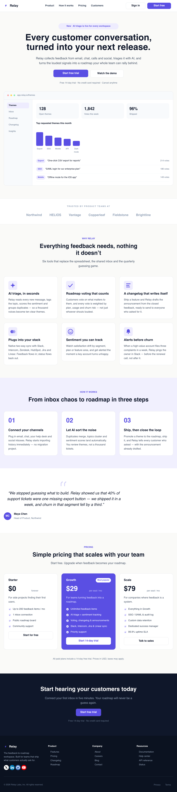

# Relay — Product Launch Landing Page

A polished, modern landing page for a fictional SaaS product launch, built
entirely with [Hyper Elements](https://hyperelements.dev) (`@hyper-elements/react`).
One template, written once in JSX, renders to a responsive static web page —
semantic HTML, flexbox, inline styles, no client-side JavaScript.

**Relay** is a fictional "feedback-to-roadmap" workspace: it collects customer
feedback from every channel, triages it with AI, and turns the loudest signals
into a product roadmap. All copy, names and numbers are original placeholder
text written for this template.

## Screenshot

<!-- SCREENSHOT: the parent agent adds a screenshot of output/landing.html here -->


*(Screenshot placeholder — render `output/landing.html` in a browser and save
a capture as `docs/screenshot.png`.)*

## What the page includes

- **Nav bar** — logo mark (drawn with Hyper Elements `Svg` shapes), `Menu` of
  sections, Sign in / Start free `Button`s
- **Hero** — announcement pill, headline, subheadline, two CTAs, trial note,
  and a **product dashboard mockup built entirely from Hyper Elements**
  components: window chrome, sidebar, stat cards, a bar chart, and a feedback
  list — no image files
- **Social proof strip** — six fictional customer wordmarks
- **Features** — a 3-column `Grid` of six cards, each with a custom `Svg` icon
- **How it works** — three numbered steps
- **Testimonial** — quote, avatar and attribution
- **Pricing** — three tiers with a highlighted Growth plan, feature checklists
  and full-width CTAs
- **Final CTA banner + footer** — dark sections with `Menu` columns and
  `Social` profile icons

## How Hyper Elements is used

- **Root:** a single `<Page>` (width 1120) — the page output: responsive web
  HTML, one element per element, no JavaScript.
- **Brand theme:** `src/theme.ts` defines the Relay brand once with
  `defineTheme` — colors, fonts, a heading type scale, `Button` defaults and
  `secondary` / `light` variants, and named `card` / `pill` styles applied
  with `style={{ apply: ["card"] }}`. Accent violet `#5A4FE3`, ink `#0F172A`,
  warm off-white `#FAFAF8`.
- **Layout elements:** `Section` bands (full-window backgrounds), `Row`
  (side-by-side, stacks on phones), `Column` (cards), `Grid` (features),
  plus `Heading`, `Text`, `Button`, `Divider`, `List`/`ListItem`, `Table`-free
  data display, `Menu`, `Social`, `Svg` + `Rect`/`Circle`/`Path`/`Line`/
  `Polygon` shapes for the logo, icons, window dots and quote mark, and
  `Span`/`Link` inline text.
- **Responsive + interactive:** `mobile:` styles shrink headings on phones,
  `Rows` stack, the mockup sidebar hides on mobile (`hidden={{ mobile: true }}`),
  and `hover:` styles darken buttons. The output stylesheet carries the phone
  media queries and hover rules.
- **Validation:** `npm run check` runs `validate()` (all checks pass) and
  prints `outline()` — every block with its resolved px width.

## Run it

```bash
npm install
npm run render   # renders src/LandingPage.tsx -> output/landing.html (+ .txt)
npm run check    # validate() + outline(); exits 1 on any error
```

Then open `output/landing.html` in a browser. No server, no build step, no
live deployment needed. Requires Node 18+ and React 18+ (installed as
dependencies).

## Customize it

- **Rebrand:** edit the accent/ink colors and fonts in `src/theme.ts`.
- **Rewrite the copy:** every string lives in `src/data.ts` (features, steps,
  pricing tiers, mock dashboard data) and `src/sections.tsx`.
- **Change the product:** rename Relay in `src/data.ts` (`product.name`) and
  swap the logo bolt in `src/icons.tsx` (`LogoMark`).
- **Add a section:** add a component in `src/sections.tsx` and drop it into
  the `<Page>` in `src/LandingPage.tsx` — it must be a direct child `Section`
  of the root.

## Notes

- The top nav renders as a static bar: Hyper Elements' `Page` output has no
  fixed/sticky positioning, so the nav does not stick on scroll.
- The "Watch the demo" button and footer links use `#` placeholder targets,
  as is normal for a template.
- All data shown in the dashboard mockup is sample data.

## Challenge

Built for the **Unlayer Hyper Elements Template Challenge** ($500 prize pool,
five winners of $100, deadline 29 November 2026). License: MIT.
